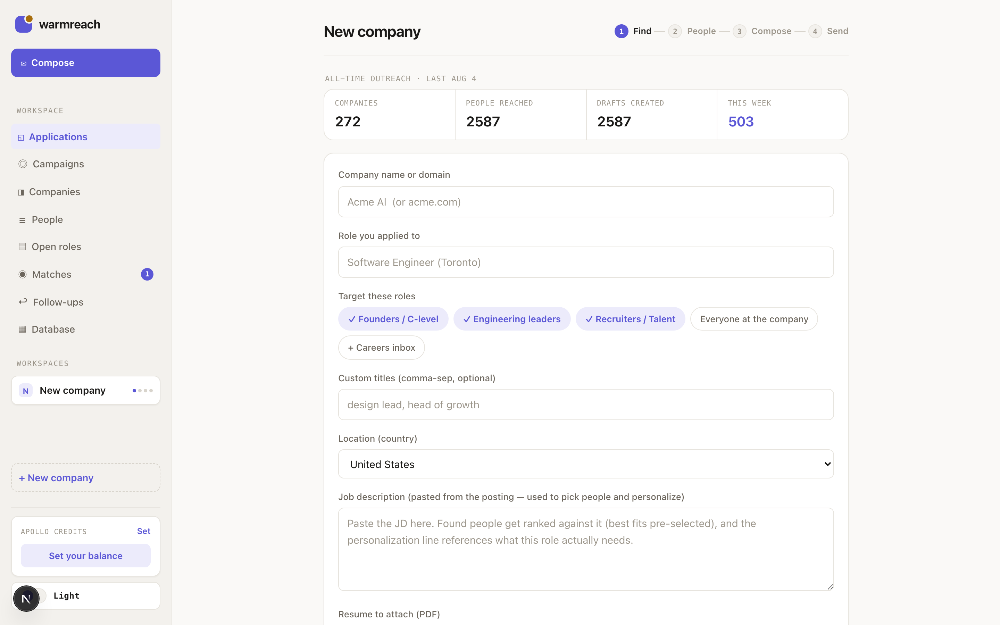
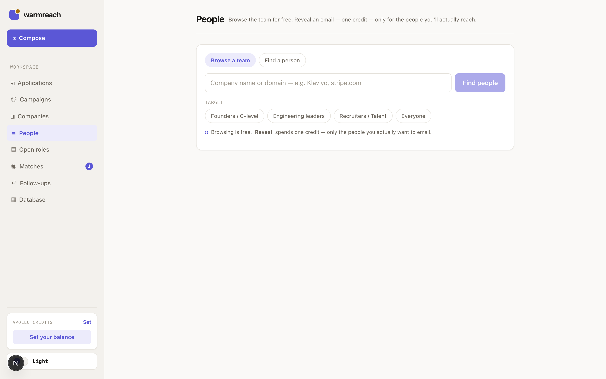
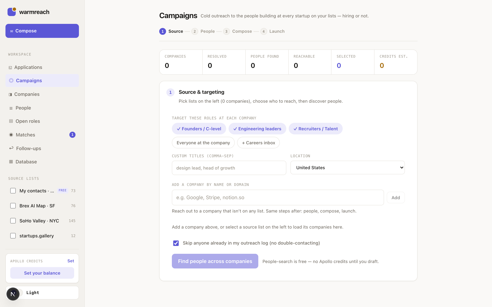
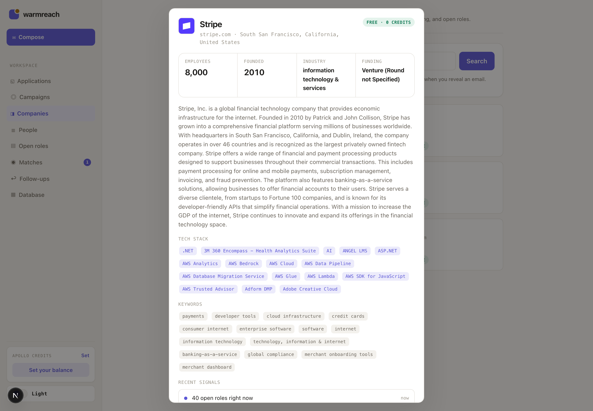
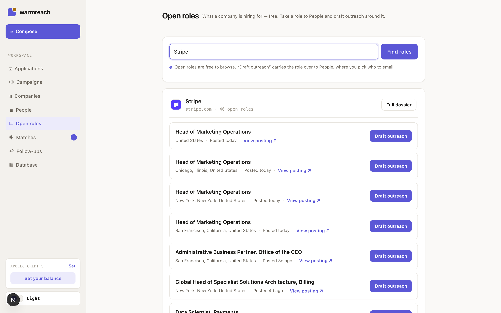
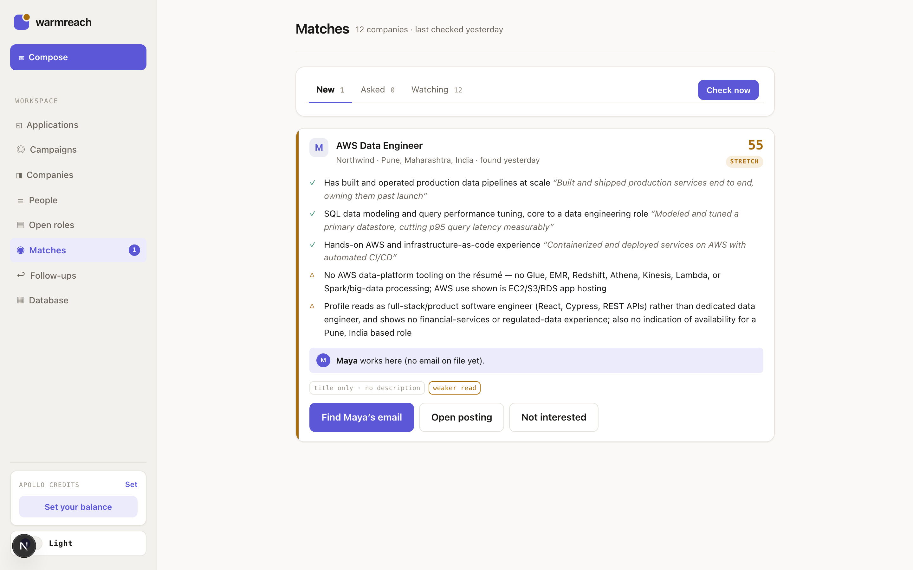
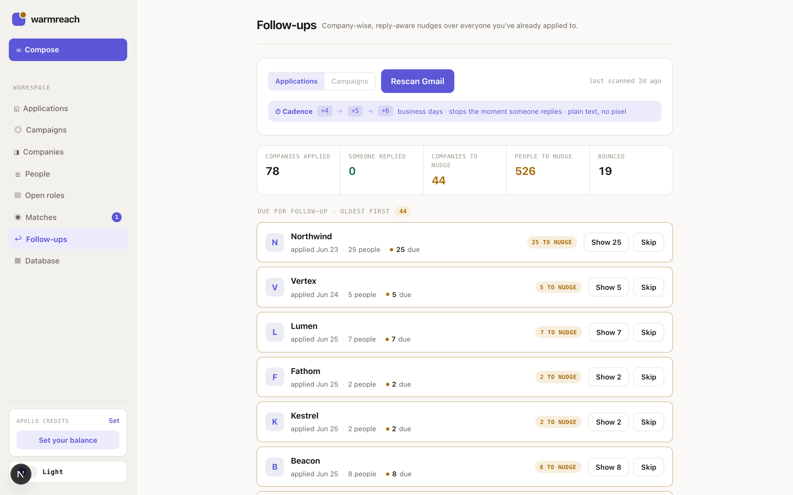

# warmreach

Cold outreach made warm. After you apply for a job, warmreach finds the right people at the company (recruiters, founders, engineering leads), writes each of them a personalized email grounded in real company facts, and lands the results as Gmail drafts — resume attached, ready for you to review and send.

https://github.com/user-attachments/assets/9c3a92ec-c251-4769-86a0-0fc60bbdbaa4

Pipeline: **Apollo** (find people → verified emails, with optional Hunter.io fallback) → **Claude** (personalize each email from real company facts and the job description) → **Gmail** (drafts, never auto-sent). Every contact is logged to `data/outreach_log.csv` so you never double-contact anyone.



> Screenshots and the video use placeholder names, companies, and addresses. The real app runs entirely on your own data, on `localhost`, and none of it is in this repo.

## Web app

```bash
npm run dev   # → http://localhost:3013
```

The web UI is the main way to use warmreach:

1. **Find people** — enter company + role (paste the JD for better results); candidates are ranked against the JD and the best fits are pre-selected.
2. **Pick a template** — use a saved email template, write a new one inline, or let Claude write from scratch; add per-run instructions or reusable prompt presets.
3. **Generate** — Claude composes one email per contact, personalized to the company and audience (recruiter vs. engineer).
4. **Review & send** — edit inline, create Gmail drafts, then send from the app or from Gmail.

Workspaces live in browser tabs and persist across reloads. All API routes reject non-local requests — this is a personal tool meant to run on `localhost`.

## Screens

**People** — browse a company's team for free; a credit is spent only on the people you actually reveal. **Campaigns** — the same flow in bulk, driven from a saved prospect list.

| People | Campaigns |
|---|---|
|  |  |

**Companies** and **Open roles** — free Apollo lookups. A dossier gives you headcount, tech stack, funding, and what the company is hiring for, and a role can be carried straight into outreach as context.

| Companies | Open roles |
|---|---|
|  |  |

**Matches** — warmreach watches the companies you care about, scores each new posting against your resume, and tells you honestly where you're a stretch. **Follow-ups** — company-wise nudges that stop the moment someone replies.

| Matches | Follow-ups |
|---|---|
|  |  |

## CLI

```bash
npm run warmreach -- "<company or domain>" --role "<role>" [--max N] [--dry-run]
```

- `--max N` — cap contacts enriched (default 5; each enrichment = 1 Apollo credit).
- `--dry-run` — skip Gmail, just print + log.

## Setup — by hand, or just hand this file to Claude/GPT and it'll set you up 🤖

```bash
npm install
cp .env.example .env                     # then paste your keys
cp src/profile.example.ts src/profile.ts # then fill in your details
```

- `.env` needs `APOLLO_API_KEY` and at least one model key. `GEMINI_API_KEY` and `GROQ_API_KEY` are free and write the emails (Gemini first, Groq when its quota runs out); `ANTHROPIC_API_KEY` is needed for the résumé tailor, and for emails only if you list `claude` in `LLM_PROVIDERS`. `HUNTER_API_KEY` is optional.
- `src/profile.ts` is your identity: name, links, resume location, the experience bullets and signature that go verbatim into every email. It is git-ignored.

### Gmail (optional, for auto-drafts)

Without this, the tool prints the emails so you can paste them. To auto-create drafts:

1. [console.cloud.google.com](https://console.cloud.google.com) → new project.
2. **APIs & Services → Library** → enable **Gmail API**.
3. **OAuth consent screen** → External → add your Gmail as a **Test user**.
4. **Credentials → Create credentials → OAuth client ID → Desktop app** → Download JSON.
5. Save it as `credentials/credentials.json`.
6. `npm run gmail:auth` (opens a browser once; saves `credentials/token.json`).

## Résumé tailor (`/resume`)

Point it at a job description and it rewrites your one-page LaTeX résumé to fit
that role — without inventing anything and without pushing you onto a second
page. Editor on one side, the real compiled PDF on the other (side-by-side or
stacked, for a landscape or portrait monitor).

Open `/resume` and your one-pager is already there, compiled — it's the first
entry in the sidebar and edits `data/resume/base.tex` in place. To tailor: paste
the posting into the **Tailor** tab on the right, fill in company and role, and
press the button. From the base one-pager that forks a copy filed under that
role rather than touching your master; from a role résumé it re-tailors in
place. Review the diffs, tick the ones you want, Apply.

Two guarantees do the work:

- **Nothing is invented.** Every bullet must come from `data/resume/master.json`,
  a bank built from your own master résumé and one-pager. A suggestion that
  can't name the bank entry it came from is dropped before it reaches the page.
- **The page doesn't move.** Each bullet's line count and character budget are
  measured by typesetting it at its real width, not estimated. Proposed rewrites
  are measured the same way *before* they're applied, and anything that missed
  is sent back for another pass — so a bullet can't silently grow a line.

Requires a LaTeX engine: `brew install tectonic` (≈50 MB; the first compile
fetches packages, later ones take ~0.5s). `brew install poppler` is optional and
enables the copy-paste test — it pulls the text back out of the finished PDF the
way a résumé parser would, which is what catches the fi/fl ligature trap where
"workflow" renders perfectly and extracts as an unsearchable ligature codepoint.

Everything on the page is free and local except the **Tailor** button, which is
one Sonnet call plus narrow retries (~5–10¢ per role).

## Layout

- `app/` — Next.js web app (UI + local-only API routes)
- `src/apollo.ts` — company resolve, people search, enrichment
- `src/hunter.ts` — Hunter.io email-finder fallback
- `src/llm.ts` — one forced tool call over Gemini → Groq → Claude, with fallback
- `src/personalize.ts` — composes each email
- `src/gmail.ts` — OAuth + draft creation/sending
- `src/templateStore.ts` — saved email templates (`data/templates.json`)
- `src/tracker.ts` — CSV log + dedupe
- `src/latexEngine.ts` — compiles the résumé, reads the engine's own log
- `src/texDoc.ts` — parses the .tex into bullets, splices edits back by offset
- `src/texFit.ts` — measures line counts and fill by typesetting each fragment
- `src/resumeTailor.ts` — the JD → bullets model call, bounded by the bank
- `src/resumeAts.ts` — ATS checks, run against the extracted PDF text
- `src/profile.ts` — **your details** (git-ignored; copy from `profile.example.ts`)
- `src/index.ts` — the CLI

## Security

Keys live in `.env` (git-ignored). `credentials/`, `data/`, and `src/profile.ts` are git-ignored too — never commit them. The only Gmail scope requested is `gmail.compose`; nothing is ever sent without you clicking Send.
